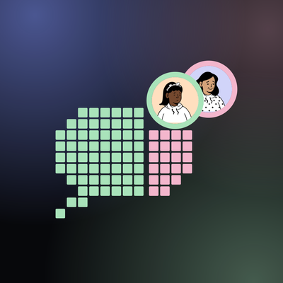
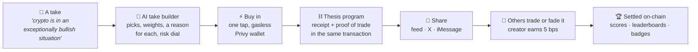
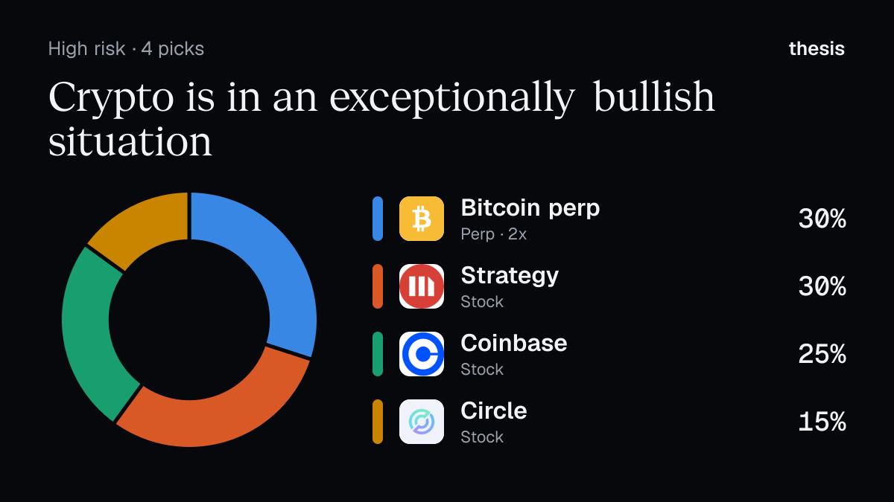
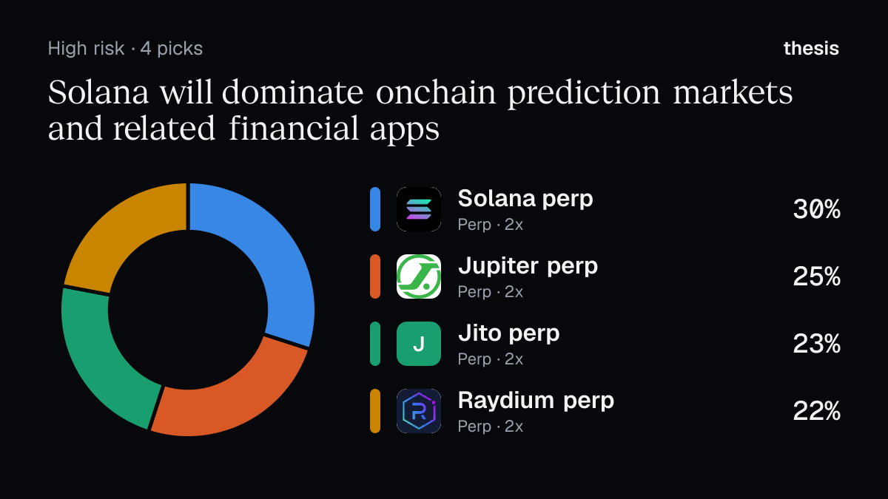
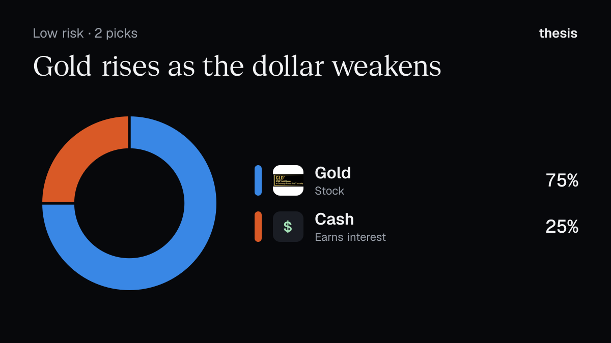
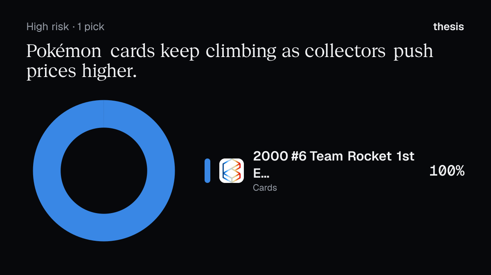
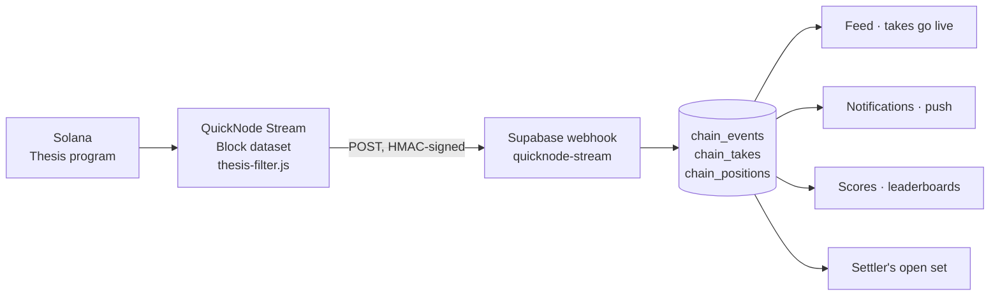
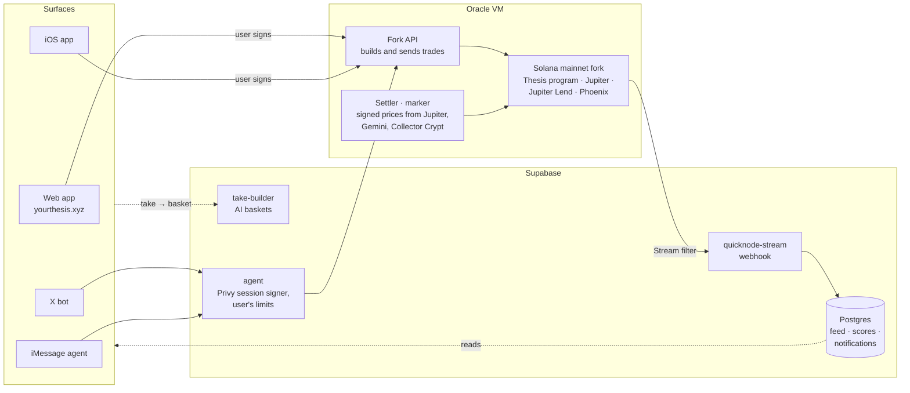

<p align="center"></p>

<h1 align="center">Thesis</h1>

<p align="center"><b>Say a take. AI turns it into a real portfolio. Friends trade it or fade it from the app, from X or from iMessage, and Solana keeps score.</b></p>

<p align="center">
  <a href="https://yourthesis.xyz"><b>yourthesis.xyz</b></a> (live web app) ·
  <a href="https://x.com/yourthesisxyz"><b>@yourthesisxyz</b></a> (live X bot) ·
  <a href="media/demo-film/film/out/thesis-film-walkthrough.mp4"><b>Demo film</b></a>
</p>

<p align="center"><b>Consumer Applications</b> · <b>Best use of Solana</b> · <b>Gemini Prediction Markets</b> · <b>QuickNode Streams</b></p>

---

| ⚡ | |
|---|---|
| **~2 s** | from an opinion to a basket of real assets, with a reason for every pick |
| **0.35–0.5 s** | from tapping Trade to *"You're in"*, gasless, no wallet pop-up |
| **5 asset classes** in one basket | tokenized stocks and ETFs, perps up to 5x, Gemini prediction markets, trading cards, yield |
| **4 surfaces** | web app, X bot, iMessage agent, native iOS app |
| **6 mainnet programs** composed with ours | Jupiter, Jupiter Lend, Phoenix, Ember, Associated Token, Compute Budget |
| **1 receipt** per trade, on-chain | with proof that the money was really traded |

Market opinions live in group chats and on X, and nobody can act on them. *"AI power demand is underrated"* has no ticker, the chat has no buy button, and nobody keeps score.

**Thesis turns the opinion itself into the trade.** Type a take, and an AI builds a basket across every asset class Solana has to offer. Buy in with one tap, and the take, its basket and your entry prices are frozen on-chain. Anyone can then **trade** it (buy the same basket) or **fade** it (bet against it) from the app, by replying under any post on X, or by texting the iMessage agent. Every account has a public, on-chain track record, and creators earn a cut of every trade on their takes.

It's live: [yourthesis.xyz](https://yourthesis.xyz) runs on a full fork of Solana mainnet, with the real Jupiter, Phoenix and USDC programs and $1,000 of play money per account.

## How it works



<table>
  <tr>
    <td></td>
    <td></td>
  </tr>
  <tr>
    <td></td>
    <td></td>
  </tr>
</table>

<sub>Real baskets the X bot built from people's posts, as it attaches them to its replies. They're drawn by the web app at <code>/d/&lt;id&gt;/basket.png</code>, with no model involved.</sub>

## What it does

**🧠 Opinion → portfolio.**
- The take builder sees the entire tradeable catalog: every tokenized stock, ETF, perp and yield vault in a cached prompt, plus a BM25 index over every live Gemini prediction market.
- It picks 1–5 positions that move *with* the take, each with a reason.
- When nothing trades cleanly, it says so ("no clean exposure") instead of inventing a basket.
- Bearish takes work: *"crypto sucks"* is built as the basket it's against and held short (an **inverted** take).
- Edit the basket in plain words ("add AMD", "less crypto") or by hand.
- **Benchmarked:** in a blind A/B on 100 takes with 5 LLM judges, the shipped builder beat our earlier embeddings builder **57–15** at a median **2.1 s** ([eval](packages/take-builder/eval/RESULTS.md)).

**🎚️ Risk appetite changes the instruments.**

| Risk | The basket |
|---|---|
| **Low** | About 4 spread-out picks (big names, broad ETFs) plus 20–30% USDC earning yield in Jupiter Lend |
| **Medium** | About 5 stocks, ETFs or commodities, plus a Gemini prediction market when the take implies an outcome; cards can join |
| **High** | The purest names, plus a Phoenix perp at 2–5x leverage chosen by the model, with liquidation warnings |

**🌐 Every asset class in one basket.**

| Asset class | Venue | Held as |
|---|---|---|
| Tokenized stocks and ETFs (xStocks, Ondo, …) | Jupiter, best issuer per stock, routed across 13+ Solana DEXes | Real tokens in your wallet |
| Perps and shorts | Phoenix | Real positions, one isolated subaccount per leg |
| Prediction markets | Gemini | Filled at Gemini's live prices, scored on-chain |
| Trading cards | Collector Crypt | Priced at the card's insured value, scored on-chain |
| Yield | Jupiter Lend | Real jlUSDC vault shares |

**🔁 Trade, fade, sell.** Trading a take buys its basket. Fading it shorts the stock and crypto legs on Phoenix and takes the other side of every prediction. You can sell all or part of a position, by % or $, any time. Trades are built before you tap, and you see *"You're in"* in under half a second.

**𝕏 Trade any post on X.** Reply under **any post** with `@yourthesisxyz`:

| Reply | What happens |
|---|---|
| `back $20` | Reads the post, builds a basket, buys it from your account within your limits, and replies with the basket picture. The post becomes your take |
| `fade $20` | The same, betting against the post |
| `sell half` | Sells your position from inside the thread |
| `score @handle` | That account's Thesis record (own P&L, made for backers, takes), drawn as a P&L card |
| `copy` | Auto-copies the account: each new call it makes becomes a trade for you |

**🔄 Copy trading.** Follow an X account and each call it posts becomes your take, traded within about 16 minutes. Follow a Thesis trader and their new takes are backed for you. It's $20 a call and 3 a day by default, all inside the limits you set.

**💬 iMessage agent.** Text it *"make this a take for $20: gold to 5k"*, *"I'm in for $50 on Jake's take"*, *"fading Jake for $25"* or *"sell half my nvidia take"*. A "yes" or a like confirms each trade.

**🔗 Share from anywhere.** An article or X post shared into Thesis (the iOS share sheet, or by tagging the bot) becomes a drafted take, credited to its source.

**🏆 Social, scored on-chain.**
- **Two public scores per account:** *Own P&L* and *Made for backers* (what everyone who backed your takes made).
- **Leaderboards:** own P&L, backers, and a **faders** board for the best contrarians. By week, month or all time, in $ or %.
- **Receipts:** every take is an immutable on-chain account (basket, weights, entry prices). Every signed price links to its source document in a public `price_audit` table.
- **"Called it" badges:** non-transferable Token-2022 tokens, so reputation can't be bought.
- **Feed, follows, comments, notifications and web push.**

**💸 Creators get paid.** Every trade or fade pays a 0.10% fee, split on-chain at execution, and **half goes to the take's author**, on fades too. One tap claims it all. Copiers never pay extra.

---

## 🏅 Why Thesis wins each track

### Consumer Applications: the crypto is invisible
- **Sign in with X, Google or email.** A Privy embedded wallet appears at sign-in. There's no seed phrase, no extension and no SOL, and **the app pays every fee and every rent deposit**.
- **One tap, half a second.** Trades are pre-built and signed silently. Users see *"You're in"*, never a transaction.
- **It lives where people already talk:** an installable mobile-first web app, the X bot, an iMessage agent and a native SwiftUI iOS app.
- **Built to come back to:** a feed of friends' calls, live returns, leaderboards, notifications when someone trades or fades you, daily position digests, badges and auto-copy.
- **Safe by default:** play money ($1,000 per account), per-trade and daily limits on anything an agent does, revocable any time, and a confirmation before every texted trade.

### Best use of Solana
**Program ID:** `HbuuheBxMwf3FVwPYgqzTYdC3uHxqAQCky16rem4wbVe`, Anchor 1.2.2 ([`anchor/programs/thesis`](anchor/programs/thesis)). It's deployed at its real address on our **Surfpool fork of Solana mainnet**, which every surface uses. That gives us every real mainnet venue, liquidity and transaction-size limit, with fake money. Devnet has none of these venues.

**Programs Thesis composes with**, in the same transactions as its own receipt:

| Program | ID | What it does in Thesis |
|---|---|---|
| Jupiter Aggregator v6 | `JUP6LkbZbjS1jKKwapdHNy74zcZ3tLUZoi5QNyVTaV4` | Spot legs: tokenized stocks, ETFs, commodities, coins, routed across Orca, Raydium, Meteora, OpenBook, Phoenix and more |
| Jupiter Lend Earn | `jup3YeL8QhtSx1e253b2FDvsMNC87fDrgQZivbrndc9` | Yield legs: USDC into jlUSDC, redeemed on sale; the share's value is the leg's price |
| Phoenix | `EtrnLzgbS7nMMy5fbD42kXiUzGg8XQzJ972Xtk1cjWih` | Perp legs and fade shorts: trader registration, isolated subaccounts, market orders, closes, margin withdrawal |
| Ember | `EMBERpYNE6ehWmXymZZS2skiFmCa9V5dp14e1iduM5qy` | USDC ⇄ PhUSD for Phoenix collateral |
| Token-2022 | `TokenzQdBNbLqP5VEhdkAbS1EaM1z7sbJNNvM8k1MQd` | xStocks (with their ScaledUiAmount multiplier) and our non-transferable badges with on-chain metadata |
| SPL Token, Associated Token, System, Compute Budget | | USDC, token accounts the app pays for, per-transaction compute limits |
| Address Lookup Tables, Instructions sysvar | | Multi-leg baskets in one v0 transaction; proof-of-trade checks |

Card legs price from Collector Crypt's card data (the insured value, signed on-chain by the settler), and prediction legs from Gemini's API.

**What the program does:**
- **Non-custodial receipts:** the user's wallet does the swaps, and the receipt is recorded in the same transaction. The program never holds user funds; it escrows only paper legs' share, and returns all of it.
- **Proof of trade:** `begin_trade` / `trade_step` bracket the venue instructions and read the Instructions sysvar to enforce three things:
  - only allowlisted programs run inside the bracket;
  - the owner's USDC drops by exactly the stake;
  - each leg's output account grows.

  A receipt can't be faked, and every attack has a failing test ([`hardening-plan.md`](docs/hardening-plan.md) §1). Baskets too big for one transaction split into per-transaction brackets.
- **On-chain economics and scoring:**
  - The 10 bps fee and the 5 bps creator share are config values, split at execution.
  - Creators claim from the take account.
  - Settler-signed prices settle each position into the owner's `Profile` (P&L, stake, wins), and the program mints badges.
- **Production-grade:**
  - **Self-CPI events** (`emit_cpi!`), so big trades never lose events to log truncation.
  - **Tests:** LiteSVM and property tests, with compute and rent ceilings enforced in CI.
  - **Security:** a security review, two-step admin hand-over and a separate allowlist key.
  - **Verifiable builds** (`solana-verify`).

### Gemini Prediction Markets
Prediction markets become **first-class legs in every basket**, so Gemini's data reaches a social, on-chain app, next to stocks and perps.
- **AI market discovery:** every open Gemini contract, in all categories, is indexed for the take builder's BM25 search. A take about a rate decision, an election or a game picks up the matching contract by itself.
- **Live pricing:** a prediction leg fills at the side's live best ask. It exits at the best bid, or at 1 or 0 once the contract resolves. A fade takes the other side.
- **Scored on-chain:** the settler signs Gemini entry and exit prices into the Thesis program, so prediction legs count in the same P&L, leaderboards and badges as everything else.
- **Endpoints** (Gemini Prediction Markets API, market data):
  - `GET /v1/prediction-markets/categories`
  - `GET /v1/prediction-markets/events`
  - `GET /v1/prediction-markets/events/<ticker>`

  They're read through our Supabase `gemini` proxy, which trims each event to ~1.5 KB. A full sweep runs every 6 hours, and trades and settlement read single events live. Quotes come only from `bestBid` / `bestAsk`, never from last-trade fills.

More: [`gemini-plan.md`](docs/gemini-plan.md).

### QuickNode Streams
QuickNode Streams is the **source of truth for the whole social layer**: feed counts, takes going live, notifications, both scores and every leaderboard are built from Thesis program events the Stream delivers.



| Setting | Value | Why |
|---|---|---|
| Network | Solana mainnet | The program's network |
| Dataset | **Block** | Includes inner instructions, so CPI calls and self-CPI events are visible |
| Batch | 5 blocks, elastic, restream on reorg | Tip Streams on Solana batch ≥5; elastic still delivers per block |
| Filter | [`thesis-filter.js`](infra/quicknode/thesis-filter.js) | Only Thesis transactions get through, already decoded (below) |
| Destination | Webhook → Supabase `quicknode-stream` | Lands straight in the tables the apps read |

**The filter:**
1. Drops failed transactions.
2. Keeps a transaction only if Thesis is invoked anywhere: top level, CPI, or a program ID loaded from a lookup table.
3. Names each instruction by its Anchor discriminator.
4. Extracts the self-CPI events.
5. Trims logs to what matters.

A batch with no Thesis activity returns `null`, so nothing is delivered.

**The webhook:**
- verifies QuickNode's HMAC signature and refuses replays older than 5 minutes;
- decodes events against the program's IDL;
- ingests them idempotently per `(network, signature, ordinal)`, so retries and reorgs never double-count.

**On the fork,** a relay runs **the exact same filter** in a QuickNode-like sandbox and signs deliveries like QuickNode, so production's webhook path is exercised on every trade. **QuickNode RPC also powers the fork itself:** every mainnet account it reads (Jupiter pools, Phoenix markets, xStock mints) comes through our QuickNode endpoint.

---

## Architecture



| Path | What it is |
|---|---|
| [`anchor/`](anchor) | The Thesis program |
| [`packages/chain`](packages/chain/README.md) | TypeScript client: instruction builders, the transaction composer, event decoding |
| [`packages/venues`](packages/venues/README.md) | Jupiter, Jupiter Lend, Phoenix, Gemini and Collector Crypt adapters, and the asset bank |
| [`packages/take-builder`](packages/take-builder/README.md), [`packages/agent`](packages/agent/README.md) | The take builder's catalog and eval; the chat agent behind both bots |
| [`apps/www`](apps/www/README.md), [`apps/ios`](apps/ios/README.md) | The web app and the native iPhone app |
| [`apps/x`](apps/x/README.md), [`apps/imessage`](apps/imessage/README.md) | The X bot and the iMessage bot |
| [`apps/executor`](apps/executor/README.md) | The settler (signs prices), the marker (live returns), the asset bank |
| [`scripts/fork`](scripts/fork/README.md), [`infra/`](infra) | The mainnet fork, the fork API, the VM, the Stream filter and relay |
| [`supabase/`](supabase/README.md) | Migrations, edge functions, SQL tests |

## Run it

The web app needs Node 24 and pnpm:

```sh
pnpm install
cp apps/www/.env.example apps/www/.env.local      # Privy app, Supabase URL and key, fork API host
pnpm --filter @thesis/www dev                     # http://localhost:3100
```

The program needs Rust, the Solana CLI 4.1.2 and Anchor 1.2.2:

```sh
cd anchor && anchor build && cargo test           # LiteSVM tests plus property tests
```

**Package tests:**

```sh
pnpm --filter @thesis/chain test                  # also venues, executor, fork, agent, x, imessage
```

**iOS:** `brew install xcodegen && cd apps/ios && xcodegen generate && open Thesis.xcodeproj` ([setup](apps/ios/README.md)).

Every surface talks to one shared fork on our VM ([`infra/executor`](infra/executor/README.md)). CI covers:
- the program's build, tests, fmt and clippy;
- every package's typecheck and tests;
- the web build;
- the edge functions;
- the SQL tests;
- the iOS build.

## What's next
1. **Mainnet:** deploy the verifiable build behind a safe upgrade key, with a QuickNode Stream on the live program.
2. **Real money:** USDC in over CCTP, an Apple Pay onramp, withdrawals, and the iOS app on the App Store.
3. **The Thesis MCP server:** AI assistants can score accounts and trade takes for a user, within that user's limits.
4. **More chat surfaces:** Telegram, Discord and WhatsApp, on the same agent.

The full plan: [`docs/roadmap.md`](docs/roadmap.md). The on-chain design: [`docs/onchain-plan.md`](docs/onchain-plan.md).
