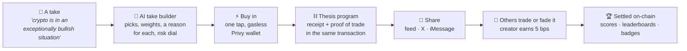
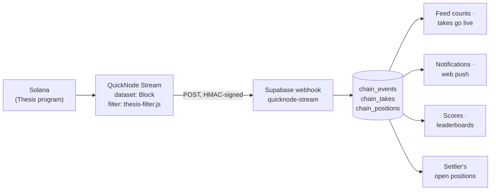
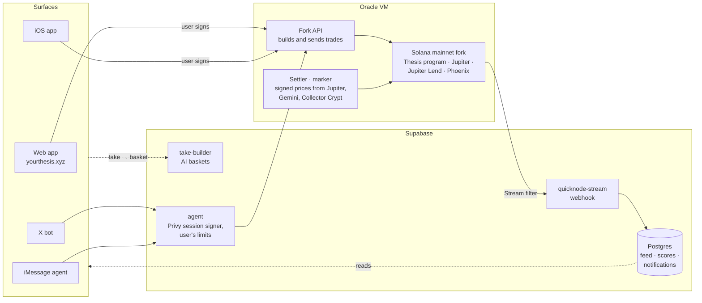
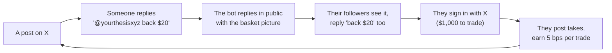

<p align="center"></p>

<h1 align="center">Thesis</h1>

<p align="center"><b>Turn any opinion into a real, tradable portfolio. Your friends can trade it or fade it, from the app, from X or from iMessage, and the chain keeps score.</b></p>

<p align="center">
  <a href="https://yourthesis.xyz"><b>yourthesis.xyz</b></a> (live web app) ·
  <a href="https://x.com/yourthesisxyz"><b>@yourthesisxyz</b></a> (live X bot) ·
  <a href="media/demo-film/film/out/thesis-film-walkthrough.mp4"><b>Demo film</b></a> ·
  Program <code>HbuuheBxMwf3FVwPYgqzTYdC3uHxqAQCky16rem4wbVe</code>
</p>

<p align="center">Consumer Applications · Best use of Solana · Gemini Prediction Markets · QuickNode Streams</p>

---

Market opinions already live in group chats and on X, but nobody can act on them. *"AI power demand is underrated"* has no ticker. Turning it into positions takes research most people skip, the chat has no buy button, and nobody keeps score, so the friend who called it gets no credit.

**Thesis fixes all three.** You type a take in plain words. An AI builds a basket of real assets for it: tokenized stocks, perps, prediction markets, trading cards and yield, with a reason for every pick. You buy in with one tap, and the take, its basket and your entry prices are frozen on Solana. Anyone can then **trade** it (buy the same basket) or **fade** it (bet against it) from the app, by replying to a post on X, or by texting the iMessage agent. Every account has a public, on-chain track record, and creators earn a cut of every trade on their takes.

It runs today on a fork of Solana mainnet with **real venues and play money**: anyone can sign up at [yourthesis.xyz](https://yourthesis.xyz) and get $1,000 to trade.

## How it works



<table>
  <tr>
    <td></td>
    <td></td>
    <td></td>
  </tr>
  <tr>
    <td align="center"><sub>High risk: a 2x Bitcoin perp plus stocks</sub></td>
    <td align="center"><sub>Low risk: gold plus cash earning yield</sub></td>
    <td align="center"><sub>Cards: a graded Pokémon card</sub></td>
  </tr>
</table>

<sub>Real baskets the X bot built from people's posts, as it posts them (rendered by the web app at <code>/d/&lt;id&gt;/basket.png</code>).</sub>

## What you can do

### 🧠 Turn a take into a trade
- **Type an opinion, get a portfolio in ~2 seconds.** The take builder reads the whole tradeable catalog (every tokenized stock, ETF, perp and yield vault in a cached prompt, plus a BM25 search over every live Gemini prediction market) and picks 1–5 positions that move *with the take*. Every pick explains why it's in.
- **It says no.** If there's no clean way to trade a take, it answers "no clean exposure" instead of inventing one.
- **Bearish takes work too.** *"Crypto sucks"* becomes the basket it's against, posted **inverted**: the author and everyone who agrees hold it short.
- **Edit in words.** "Add AMD", "less crypto", or set weights and add picks by hand.
- **Measured, not vibes.** In a blind A/B on 100 takes with 5 LLM judges, the shipped builder beat our earlier embeddings builder 57–15 (28 ties) at a median of 2.1 s ([`eval/RESULTS.md`](packages/take-builder/eval/RESULTS.md)).

### 🎚️ Risk appetite changes the instruments

| Risk | What the basket uses |
|---|---|
| **Low** | About 4 spread-out picks, big names and broad ETFs, plus 20–30% USDC earning yield in Jupiter Lend |
| **Medium** | About 5 stocks, ETFs or commodities, plus a Gemini prediction market when the take implies an outcome (a rates take: the Fed decision); Collector Crypt cards can join from here up |
| **High** | The purest names, plus a Phoenix perp at 2–5x leverage, chosen by the model from how directly the name is the take, with liquidation warnings |

### 🌐 Every asset class in one basket

| Asset class | Venue | How it's held |
|---|---|---|
| Tokenized stocks and ETFs (xStocks, Ondo, …) | Jupiter, best issuer per stock | Real tokens in your wallet |
| Yield | Jupiter Lend (jlUSDC) | Real vault shares |
| Perps and shorts | Phoenix | Real positions, one isolated subaccount per leg |
| Prediction markets | Gemini Prediction Markets | Paper fills at Gemini's live prices, scored on-chain |
| Trading cards | Collector Crypt | Paper fills at the card's insured value, scored on-chain |

### 🔁 Trade, fade, sell
- **Trade** buys the take's basket. **Fade** bets against it: Phoenix shorts on stock and crypto legs, and the other side of prediction legs. You can fade anyone's take except your own.
- **Sell all or part**, by % or $, any time. Partial sales keep each perp's leverage.
- **Fast:** trades are built while the sheet opens, so tap to *"You're in"* takes about **0.35–0.5 s**.

### 𝕏 Trade from any post on X
Reply to **any post** on X with `@yourthesisxyz`:

| Reply | What happens |
|---|---|
| `back $20` | Reads the post, builds a basket, buys it from your own account within your limits, and replies with the basket as a picture. The post becomes your take |
| `fade $20` | The same, betting against the post's view |
| `sell half` | Sells under the bot's reply or a take you hold |
| `score @handle` | Replies with that account's Thesis record: own P&L, made for backers, takes, and a P&L card |
| `copy` | Auto-copies that account: every new call it makes becomes a trade for you |

Several people replying under one post share one basket. Takes made from X carry a "Take from X ↗" tag back to the post.

### 🔄 Copy trading
Copy an **X account** (each call it posts becomes your own take, traded automatically within your limits, within about 16 minutes of the post) or a **Thesis trader** (each new take of theirs is backed for you). The defaults are $20 a call and 3 a day. Set it in the app, on any profile, or with "@yourthesisxyz copy".

### 💬 iMessage agent
Text the Thesis agent: *"make this a take for $20: gold to 5k"*, *"I'm in for $50 on Jake's take"*, *"fading Jake for $25"*, *"sell half my nvidia take"*, *"my positions"*. Every trade waits for a "yes" or a like. A first-time number gets a one-time link to connect it and set limits.

### 🔗 Share from anywhere
Share an article or an X post into Thesis (the iOS share extension, or by tagging the bot), and it drafts a take from what you read, credited to the source.

### 🏆 Social: scores, leaderboards, badges, receipts
- **Two public scores per account:** *Own P&L*, and *Made for backers*, the net P&L of everyone who backed your takes. Both are in dollars and percent, computed from on-chain events.
- **Leaderboards:** own P&L, made for backers, and a separate **faders** board for whoever made the most betting against others. By week, month or all time, sorted by $ or %.
- **Receipts:** every take is an immutable on-chain account with its basket, weights and entry prices. Every price the settler signs carries a hash of its source document, published in a public `price_audit` table, so anyone can check it.
- **"Called it" badges:** non-transferable Token-2022 tokens minted to authors (first take, first +50%, first +100%, ten at +50%, a take over +1,000%), so reputation can't be bought.
- **Feed, follows, comments, notifications and web push**, with the iOS app's look on the web.

### 💸 Creator rewards
Every trade or fade pays a 0.10% platform fee, taken by the program, and **half of it (5 bps) goes to the take's author**, on fades too. Creators claim it from their profile with one tap (Claim all packs every claim into as few transactions as fit). Followers never pay extra for copying.

---

## 🏅 Built for the tracks

### Consumer Applications: the crypto is invisible
- **Sign in with X, Google or email.** No seed phrase, no extension, no SOL: a Privy embedded wallet is created at sign-in and **the app pays every fee and rent**.
- **One tap to trade.** Transactions are built before the tap and signed silently. Users see *"You're in"* in under half a second and never see a transaction.
- **Meets people where they already talk:** an installable mobile-first web app ([yourthesis.xyz](https://yourthesis.xyz), with a phone layout and QR code on desktop), the X bot, the iMessage agent and a native SwiftUI iOS app (development builds; App Store in phase 3).
- **A daily habit:** a feed of friends' calls, live returns, leaderboards, notifications when someone trades or fades you, daily position digests, and auto-copy.
- **Safe defaults:** $1,000 of play money per account, per-trade and daily limits for anything the agents do, revocable any time, and a confirmation before any texted trade.

### Best use of Solana
**Program ID:** `HbuuheBxMwf3FVwPYgqzTYdC3uHxqAQCky16rem4wbVe` (Anchor 1.2.2, [`anchor/programs/thesis`](anchor/programs/thesis)). It's deployed at that address on our **Surfpool fork of Solana mainnet**, where every venue is the real mainnet program (Jupiter, Jupiter Lend, Phoenix, the real USDC mint) and the money is fake. Devnet has none of these venues, which is why we test on a mainnet fork.

- **Non-custodial receipts:** the user's own wallet does the swaps, and the Thesis program records the receipt **in the same transaction**. The program never holds user funds; it escrows only the paper legs' share and returns all of it.
- **Proof of trade:** a receipt can't be faked. `begin_trade` / `trade_step` bracket the venue instructions and use the Instructions sysvar to check that:
  - only allowlisted programs run inside the bracket;
  - the owner's USDC drops by the exact stake;
  - each leg's output account grows.

  Every attack has a failing test ([`docs/hardening-plan.md`](docs/hardening-plan.md) §1).
- **Composability:** one versioned transaction packs Jupiter swaps, Jupiter Lend deposits and Phoenix orders with the receipt, using address lookup tables. A basket that doesn't fit is split into per-transaction brackets.
- **On-chain fee split:** the 10 bps fee and the 5 bps creator share are config values, collected and split at execution.
- **On-chain scoring:** the settler signs entry, sale and exit prices, positions settle into each wallet's `Profile` (raw P&L, stake, wins), and the program mints badges as **non-transferable Token-2022 tokens with on-chain metadata**.
- **Built to ship:**
  - **Self-CPI events** (`emit_cpi!`), so big trades can't lose events to log truncation.
  - **Tests:** LiteSVM tests and property tests (`proptest`), with a compute and rent check on every instruction.
  - **Security:** an internal security review ([`docs/security-review.md`](docs/security-review.md)) and two-step admin hand-over.
  - **Verifiable builds** in CI (`solana-verify`).
- **Solana-native UX:** Privy embedded Solana wallets, gasless for users (the app's fee payer pays rent and fees), and Token-2022 xStocks with their ScaledUiAmount multiplier handled in pricing.

### Gemini Prediction Markets bounty
Gemini prediction markets are **first-class legs in every basket**, so prediction market data reaches a social, on-chain app.
- **Market discovery by AI:** the take builder indexes every open Gemini contract (all categories) and BM25-searches them on the take's words, so a take about a rate decision, an election or a game can hold the matching contract next to stocks and perps.
- **Live prices:** a trade's prediction leg fills at the side's live **best ask**. It exits at 1 or 0 once resolved, else at the best bid at the sale. Fades take the other side.
- **Scored on-chain:** the settler signs the Gemini entry and exit prices into the Thesis program, so prediction legs count in the same P&L, leaderboards and badges as stocks and perps.
- **API endpoints used** (Gemini Prediction Markets API, market data):
  - `GET /v1/prediction-markets/categories`
  - `GET /v1/prediction-markets/events` (paged by status and category)
  - `GET /v1/prediction-markets/events/<ticker>`
- **How we read them:**
  - All reads go through our Supabase `gemini` proxy, which trims events to the fields we use (`slimEvent`: one event is ~1.5 KB).
  - The asset bank sweeps every contract every 6 hours.
  - The fork API and the settler read single events live.
  - Quotes come only from `bestBid` / `bestAsk`, never from last-trade fills.
- Details: [`docs/gemini-plan.md`](docs/gemini-plan.md), [`packages/venues/gemini`](packages/venues/README.md#gemini).

### QuickNode Streams bounty
On-chain events are the source of truth for the whole social layer: the feed's counts, notifications, posting confirmation, both scores and every leaderboard all come from Thesis program events delivered by a QuickNode Stream.



**How the Stream is configured** ([`infra/quicknode`](infra/quicknode/README.md)):

| Setting | Value | Why |
|---|---|---|
| Network | Solana mainnet | Where the program lives (on the fork, see below) |
| Dataset | **Block** | The documented `getBlock` shape, with inner instructions, so CPI calls and self-CPI events are visible |
| Batch | 5 blocks, elastic batch, restream on reorg | Solana tip Streams must batch ≥5; elastic still delivers as blocks arrive |
| Filter | [`thesis-filter.js`](infra/quicknode/thesis-filter.js) | Delivers only what we need (below) |
| Destination | Webhook → Supabase `quicknode-stream` | Writes straight into the tables the apps read |

**What the filter does:**
1. Drops failed transactions.
2. Keeps a transaction only if the Thesis program is invoked anywhere: top level, CPI, or a program ID loaded from a lookup table.
3. Names each instruction by its Anchor discriminator.
4. Extracts the program's self-CPI events (base64 discriminator plus Borsh).
5. Trims logs to `invoke` / `success` / `failed` lines plus what Thesis itself logged.

It returns `null` for a batch with no Thesis transactions, so nothing is delivered.

**The webhook:**
- verifies QuickNode's HMAC signature (`X-QN-Nonce` + `X-QN-Timestamp` + body) and refuses requests older than 5 minutes;
- decodes events with the program's IDL;
- calls `ingest_chain_events()`, which is idempotent per `(network, signature, ordinal)`, so retries and reorg restreams never double-count.

**On the fork today:** the program isn't on mainnet yet, so [`fork-relay.ts`](infra/quicknode/fork-relay.ts) runs **the exact same filter** in a QuickNode-like sandbox and signs its deliveries the way QuickNode does. The webhook and every table it feeds run the production code path. Tests run the filter on recorded blocks and fail if its instruction table drifts from the IDL.

**QuickNode RPC is also the fork's datasource:** every mainnet account the fork reads (Jupiter pools, Phoenix markets, xStock mints) comes through our QuickNode Build endpoint.

---

## Architecture



| Path | What it is |
|---|---|
| [`anchor/`](anchor) | The Thesis program: takes, receipts with proof of trade, fee split, paper-leg escrow, settlement, badges |
| [`packages/chain`](packages/chain/README.md) | TypeScript client: instruction builders, the transaction composer, event decoding |
| [`packages/venues`](packages/venues/README.md) | Jupiter, Jupiter Lend, Phoenix, Gemini and Collector Crypt adapters, and the asset bank |
| [`packages/take-builder`](packages/take-builder/README.md) | The take builder's catalog and its eval (the builder runs as a Supabase function) |
| [`packages/agent`](packages/agent/README.md) | The chat agent shared by the X bot and the iMessage bot |
| [`apps/www`](apps/www/README.md) | The public web app at yourthesis.xyz |
| [`apps/ios`](apps/ios/README.md) | The native iPhone app |
| [`apps/x`](apps/x/README.md), [`apps/imessage`](apps/imessage/README.md) | The X bot and the iMessage bot (one Railway service) |
| [`apps/executor`](apps/executor/README.md) | The settler (signs prices), the marker (live returns), the asset-bank poller |
| [`scripts/fork`](scripts/fork/README.md) | The mainnet fork and the fork API |
| [`infra/`](infra) | The VM, the QuickNode Stream filter and relay, badges, the bots' deploy |
| [`supabase/`](supabase/README.md) | Migrations, edge functions, SQL tests |
| [`media/demo-film`](media/demo-film/README.md) | The demo film and its build |

---

## Go-to-market

**Distribution is built into the product.** Every trade on X is a public reply with the basket as a picture, right under the post people are already reading. Every take is a link with a preview. Creators are paid on every trade of their takes, so they bring their followers.



- **Proven demand:** social trading already works for memecoins (Fomo: about a $550M valuation and 625K traders, per our research). Thesis brings it to opinions backed by real assets: stocks, perps, prediction markets and collectibles.
- **Zero-friction acquisition:** sign in with the X account you already use; the bot's replies are tied to it, so a reply under a post is all it takes to start.
- **Retention loops:** auto-copy, daily position digests, notifications when someone trades or fades you, leaderboards and badges.
- **Revenue:** 10 bps on every trade and fade, half to creators.
- **Costs:** the core stack runs on free tiers (Vercel Hobby, Supabase Free, Privy's 500-MAU tier, an Oracle Always Free VM); the paid pieces are QuickNode Build, Jupiter's Developer plan and X's pay-per-use API. An X reply costs $0.015, and each person gets 10 bot replies a day.
- **Load-tested:**
  - **Reads:** 200 concurrent readers with no failures, and 500 at a p90 of 2–4 s, on one free VM.
  - **Trades:** 4–5 people trading every leg type at once, every trade landed.

---

## Run it

The web app needs Node 24 and pnpm:

```sh
pnpm install
cp apps/www/.env.example apps/www/.env.local      # Privy app, Supabase URL and key, fork API host
pnpm --filter @thesis/www dev                     # http://localhost:3100
```

The program needs Rust, the Solana CLI 4.1.2 and Anchor 1.2.2 (via `avm`):

```sh
cd anchor && anchor build && cargo test           # LiteSVM tests plus property tests
```

**Checks:**

```sh
pnpm --filter @thesis/chain test                  # also @thesis/venues, executor, fork, agent, x, imessage
```

**iOS:** `brew install xcodegen && cd apps/ios && xcodegen generate && open Thesis.xcodeproj` ([setup](apps/ios/README.md)).

There's **one shared fork**, on our VM, which every surface talks to; nobody runs a fork locally ([`infra/executor`](infra/executor/README.md), [`scripts/fork`](scripts/fork/README.md)). CI runs the program's build, tests, fmt and clippy, every package's typecheck and tests, the web build, the edge functions' Deno checks, the SQL tests and the iOS build.

## What's next
1. **A private mainnet program:** deploy the verifiable build, put the upgrade authority on a safe key, and point a QuickNode Stream at it.
2. **Real money:** USDC in over CCTP and an Apple Pay onramp, withdrawals, and the iOS app on the App Store.
3. **The Thesis MCP server:** so AI assistants can score accounts and trade takes for a user within their limits.
4. **More chat surfaces:** Telegram, Discord and WhatsApp, on the same agent.

The full plan is in [`docs/roadmap.md`](docs/roadmap.md), and the on-chain design in [`docs/onchain-plan.md`](docs/onchain-plan.md).
